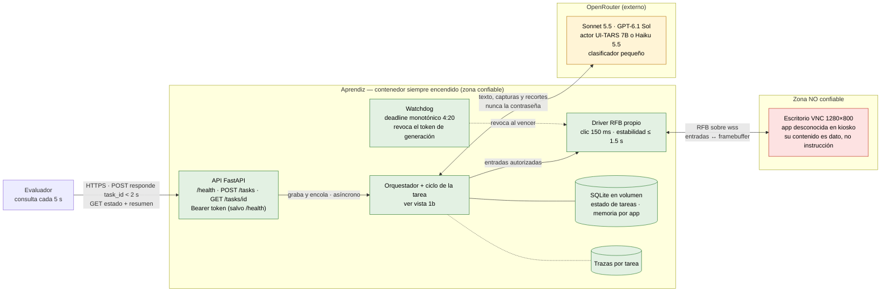
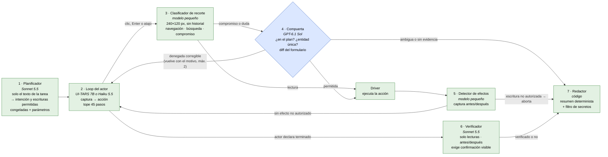
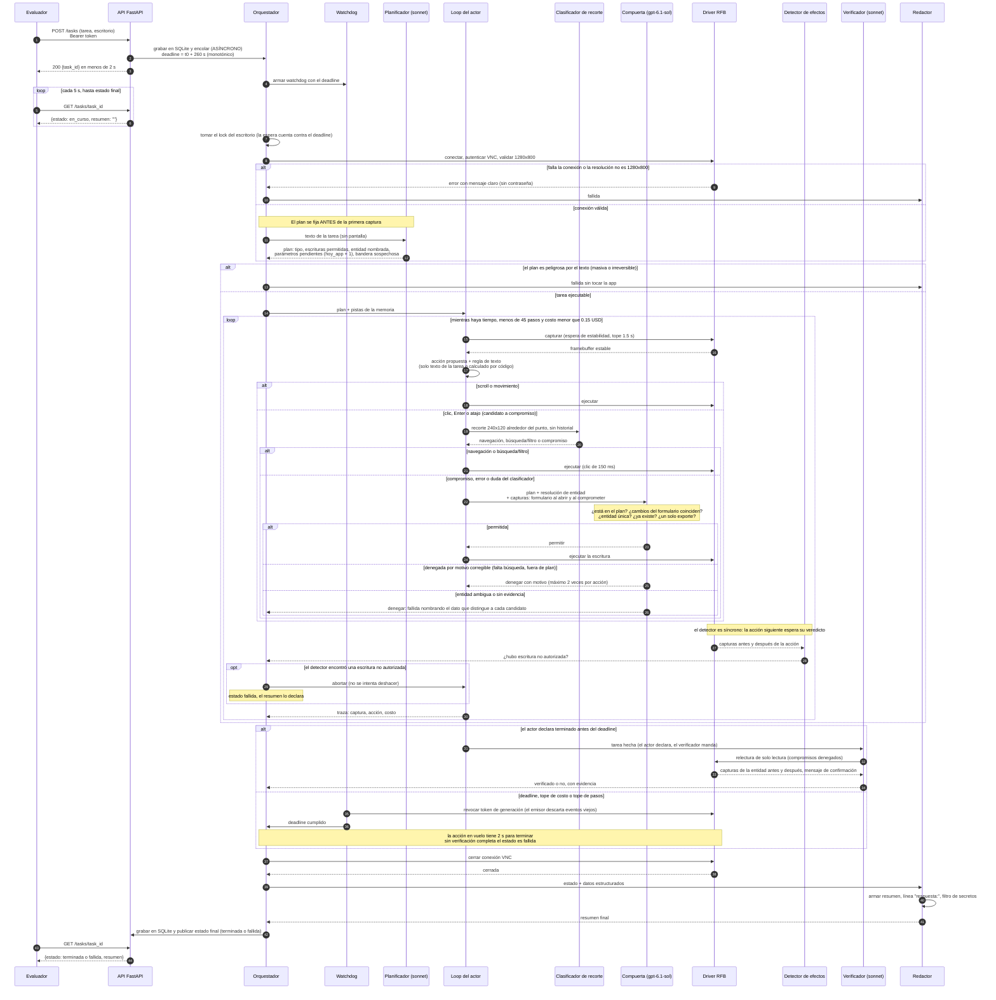

# Aprendiz — diagramas de arquitectura

Complemento de [diseno.md](diseno.md). Los diagramas están en Mermaid y se leen con cualquier visor de Markdown que lo soporte (GitHub, VS Code con extensión).

## 1. Contenedores y límites de confianza

### 1a. Contenedores

Tres zonas. Lo que viene de la **zona no confiable** (la pantalla del escritorio) es dato: puede informar al actor, pero nunca autoriza una escritura nueva. Esa autoridad solo la tiene el plan, que sale del texto de la tarea y se fija antes de la primera captura. El control de acciones es negar por defecto: todo clic o tecla que pueda comprometer pasa por el clasificador y, si lo es, por la compuerta.

### 1b. Componentes del ciclo de la tarea

Cada caja dice qué modelo usa; todas las llamadas a modelos salen por el mismo cliente con timeout, reintentos acotados y tope de costo.

Líneas continuas: control y datos dentro del servicio. Punteadas: llamadas a modelos, almacenamiento y el watchdog.

Qué marca cada límite:

| Límite | Qué lo cruza | Regla |
| --- | --- | --- |
| Cliente → servicio | Tarea y credenciales del escritorio | Bearer token en `POST /tasks` y `GET /tasks/{id}`; `/health` no lo exige y lo acepta si viene. La contraseña del escritorio solo se usa en la autenticación VNC dentro del driver. |
| Servicio → proveedores LLM | Texto de la tarea, capturas, recortes, plan | La contraseña y los tokens no se envían. Las capturas sí pueden mostrar datos sensibles del negocio. Timeout y reintentos acotados en el módulo cliente. |
| Servicio ↔ escritorio | Entradas de teclado y ratón; framebuffer | Todo lo que vuelve es píxeles no confiables. Ninguna escritura se autoriza por lo que la pantalla diga. |

## 2. Secuencia de una tarea

Tres caminos de salida: cierre normal (verificador), corte de tiempo (watchdog) y aborto por escritura no autorizada. En todos, la conexión VNC se cierra antes de publicar el estado, para que ninguna acción tardía caiga en la tarea siguiente. Una denegación corregible vuelve al actor con el motivo; ambigüedad de entidad o falta de evidencia terminan la tarea `fallida`.

